# Repository purpose map

This map describes the repository's current runtime and the purpose of its major file groups. The working tree inventory contained 32,204 files: 428 tracked project files plus local dependencies and generated artifacts. Source, configuration, tests, and architecture documents are mapped from their contents and module relationships. Large dependency/build trees and opaque binary assets are grouped by their directory and build role rather than expanded into thousands of nodes.

## Runtime and project structure

```mermaid
flowchart TD
    User[Desktop user]

    subgraph Desktop["Tauri desktop application"]
        Host["src-tauri/src/main.rs + lib.rs<br/>Tauri host, command registry, app services"]
        Bootstrap["src/main.tsx<br/>Tauri-only bootstrap, storage bridge, hydration"]
        App["src/app/App.tsx<br/>Monad → world selection → desktop world"]
        WorldApp["RebuiltApp.tsx<br/>save migration, error boundary, game session"]
        Game["RebuiltGame.tsx<br/>Canvas, world scene, HUD, overlays, navigation"]
        Notebook["NotebookLayout + app/components<br/>day journal, entry editing, notebook navigation<br/>(NotebookLayout has no current App.tsx route)"]

        User --> Host
        Host --> Bootstrap
        Bootstrap --> App
        App --> WorldApp
        WorldApp --> Game
    end

    subgraph FrontendCore["src/core — domain and frontend services"]
        Store["state/citadelStore.ts<br/>canonical journal/profile state and actions"]
        StateActions["state/stateActions.ts + rules/<br/>write gate, rituals, rollover, hierarchical writes"]
        Persistence["persistence/<br/>native storage, migration, import/export, wipe, queue"]
        Security["security/<br/>vault bridge, unlock gate, lock pause, wipe epoch"]
        Model["model/<br/>journal schemas, fractal/calendar types"]
        GraphClient["graph/<br/>extract journal concepts and graph client"]
        SemanticClient["semantic/<br/>native semantic, pattern, sync, crystallization calls"]
        PlayerModel["player-model/<br/>local player model extraction and storage"]
        SigmaCore["sigma/<br/>retrieval leash, voice client, journal harvesting"]
        Rules["rules/<br/>librarian, ritual engine, write policy"]

        Store --> StateActions
        Store --> Persistence
        Store --> Model
        Store --> Notebook
        Persistence --> Security
        Persistence --> GraphClient
        Store --> SemanticClient
        Store --> PlayerModel
        SigmaCore --> SemanticClient
        SigmaCore --> Rules
    end

    subgraph UI["src/arboretum + src/features — user-facing surfaces"]
        Monad["features/monad/<br/>welcome, world selection, rituals, shaders"]
        Arboretum["arboretum/components/citadel-rebuilt/<br/>3D world, chambers, navigation, terminal, settings"]
        WorldFeatures["features/world/<br/>mindmap3d, search, world status, Bison"]
        Sigma["features/sigma/<br/>chat, citations, knowledge and conversation controls"]
        VaultUI["features/synaptic-vault/<br/>calibration, questionnaire data, synthesis, export"]
        ChronoDial["features/chrono-dial/<br/>calendar/dial visualization"]
        ThreeHelpers["arboretum/components/three/<br/>shared 3D rendering helpers"]
        Tests["src/tests/<br/>Vitest setup and frontend unit tests"]

        App --> Monad
        Game --> Arboretum
        Notebook --> WorldFeatures
        Game --> Sigma
        App --> VaultUI
        WorldFeatures --> ChronoDial
        Arboretum --> ThreeHelpers
        ThreeHelpers --> Tests
    end

    subgraph Native["src-tauri/src — native Rust services"]
        Commands["lib.rs<br/>Tauri commands and shared runtime state"]
        Vault["vault.rs + vault_storage.rs<br/>key management and encrypted WebView storage"]
        Journal["journal_log.rs<br/>signed append-only journal and day status"]
        Migration["journal_migration.rs<br/>legacy snapshot/profile import"]
        Graph["graph.rs<br/>encrypted, rebuildable Oxigraph projection"]
        Semantics["semantic_engine.rs + pattern_engine.rs<br/>local embeddings/search and horizon patterns"]
        Sync["sync/<br/>secure transport, bundle exchange, reconciliation, roster, quarantine"]
        Import["trmgts_import.rs + trismegistus.rs<br/>phone bundle import and bundle format"]
        Generation["generative_engine.rs<br/>optional local generative model runtime"]
        NativeTests["src-tauri/tests + inline Rust tests<br/>backend regression coverage and fixtures"]

        Host --> Commands
        Commands --> Vault
        Commands --> Journal
        Commands --> Migration
        Commands --> Graph
        Commands --> Semantics
        Commands --> Sync
        Commands --> Import
        Commands --> Generation
        Commands --> NativeTests
        Journal --> Graph
        Journal --> Semantics
        Sync --> Journal
        Sync --> Graph
    end

    Persistence -->|Tauri invoke / native storage| Commands
    SemanticClient -->|Tauri invoke| Commands

    subgraph BuildInputs["Build, configuration, and bundled inputs"]
        Package["package.json / package-lock.json<br/>frontend dependencies and scripts"]
        Cargo["src-tauri/Cargo.toml / Cargo.lock<br/>Rust dependencies and build profile"]
        Vite["vite.config.ts / vitest.config.ts / tsconfig.json<br/>frontend build, tests, and type checking"]
        TauriConfig["tauri.conf.json / capabilities / entitlements<br/>desktop packaging, permissions, platform settings"]
        Public["public/ + src-tauri/icons/<br/>brand images, fonts, app icons"]
        Models["src-tauri/models/<br/>MiniLM ONNX/tokenizer and optional generative model"]
        Vendor["src-tauri/vendor/<br/>locally patched Oxigraph parser dependencies"]
        Docs["docs/architecture/<br/>current-state notes, threat/design reviews, implementation plan"]
        Script["scripts/package_mac_app.py<br/>macOS application packaging helper"]

        Package --> Vite
        Cargo --> TauriConfig
        Public --> Vite
        Models --> TauriConfig
        Vendor --> Cargo
        Script --> TauriConfig
    end

    subgraph LocalArtifacts["Working-tree dependencies and generated/release artifacts"]
        NodeModules["node_modules/ — 20,207 files<br/>installed JavaScript dependencies"]
        Target["src-tauri/target/ — 11,487 files<br/>Rust, native-library, and CMake build outputs"]
        Dist["dist/ — 57 files<br/>Vite production frontend output"]
        Releases["releases/ — 12 files<br/>packaged app / installer artifacts"]
        Archive["_archive/ — local ignored archive metadata"]

        Package --> NodeModules
        Vite --> Dist
        Cargo --> Target
        TauriConfig --> Releases
    end
```

## File-group inventory

| Area | Tracked files | Purpose |
|---|---:|---|
| `src/` | 290 | React/TypeScript application, frontend domain services, UI features, and tests. |
| `src-tauri/` | 110 | Rust backend, Tauri configuration, native icons, model inputs, vendored parser crates, fixtures, and Rust tests. |
| `public/` | 12 | Static branding, imagery, fonts, and web app metadata included by Vite. |
| `docs/` | 5 | Architecture state, Sigma behavior, sync threat/failure analysis, implementation milestones, and open product decisions. |
| Root configuration | 9 | NPM manifests, Vite/Vitest/TypeScript configuration, HTML entrypoint, and repository metadata. |
| `scripts/` | 2 | Packaging helpers. |

The local, untracked working tree additionally contains `node_modules/` (20,207 files), `src-tauri/target/` (11,487), `dist/` (57), and `releases/` (12). These are dependency installation, compilation, frontend output, and distributable artifacts respectively; they are not authored source modules.

## Current-scope notes

- The supported frontend boot is Tauri-only. `src/main.tsx` activates native-backed storage and hydrates before rendering the React application.
- `src/app/components/NotebookLayout.tsx` and its day-journal UI remain in the tree but are not currently routed by `src/app/App.tsx`; the active desktop path is the Monad landing screen, world selector, and rebuilt world.
- The native journal is the source of truth for signed entries. Oxigraph, semantic vectors, and pattern results are derived/indexed services, not journal authorities.
- `docs/architecture/` contains both current-state documentation and future design recommendations; milestone tables should not be read as proof that every planned capability is shipped.
- The arcade, 3D chess, and time-capsule features have been removed from the current source tree. Bottle messages and future letters are separate features and remain.
- The bundled resources include model and visual binary assets. Their content is not meaningfully represented as individual nodes in a source architecture diagram.
